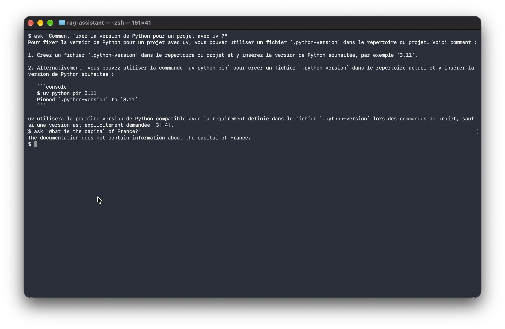

# RAG Assistant for the uv documentation

Français : [README.md](README.md)

Question-answering assistant that answers from the documentation of
[uv](https://github.com/astral-sh/uv), citing its sources. It runs entirely
locally and for free (local embeddings and local language model).


> Status: project complete, usable locally. Known limitations are described below.

## Features

- Semantic search over 634 passages (PostgreSQL + pgvector), with reranking of the best candidates
- Streaming answers (SSE); the passages consulted and their scores are
  sent separately from the answer
- Refuses to answer when the documentation does not contain the information
- Clean errors when the database or the model is unavailable

## Running the project

Prerequisites: Docker Desktop, Ollama, Python 3.9 or later.

```bash
cp .env.example .env            # then change POSTGRES_PASSWORD
ollama pull qwen2.5:7b
ollama create qwen2.5-rag -f ollama/Modelfile
docker compose up -d --build

python3 -m venv .venv && source .venv/bin/activate
pip install -r requirements.txt

./scripts/fetch_corpus.sh       # fetches the uv documentation
python -m scripts.build_chunks  # cleans and splits it into passages
python -m scripts.ingest        # computes the embeddings and fills the database
```

Asking a question:

```bash
curl -N -X POST http://localhost:8000/ask \
  -H "Content-Type: application/json" \
  -d '{"question": "How can I pin the Python version of a project?"}'
```

### Docker image

The API image already contains the embedding and reranking models (nothing is downloaded on the first call) and runs as a non-root user. The model names are read from `.env` at build time: `docker compose up -d --build`. The `./app` volume in the Compose file is meant for development and is removed on a server.

## How it works

Question → embedding → search for the 20 closest passages (pgvector)
→ reranking (the 6 best passages are kept) → prompt with numbered passages
→ language model (Ollama) → streaming answer.


### Example

One question with an answer, then an off-topic question that is refused:



The technical choices and their trade-offs are in [docs/decisions.md](docs/decisions.md) (in French).

## Tests

```bash
pip install pytest
python -m pytest -q
```

The tests run without a database or Ollama: the search and the language model
are replaced by fake components. They cover passage chunking, the prompt,
the evaluation metrics, ranking fusion, reranking, the answer events,
the HTTP API (SSE stream, question validation, 503 error and an error event
without technical details), the JSON log format, rate limiting
(429 response), unexpected search errors and the validity of the question set.

## Logging

The API writes its logs to standard output, **one JSON line per message**, so they can be filtered and analysed with tools such as `jq`. The format is defined in `app/logging_config.py` (standard library only, no extra dependency).

The level of detail is set in `.env`:

```
LOG_LEVEL=INFO
```

Possible values: `DEBUG`, `INFO`, `WARNING`, `ERROR`. To read the API logs in Docker:

```bash
docker compose logs api
```

Example line:

```json
{"time": "2026-10-30T10:30:12.456+00:00", "level": "INFO", "logger": "app.main", "message": "API started"}
```

Errors add an `exception` field with the technical detail, which stays in the logs and is never sent back to the client. The lines from the `uvicorn` server (startup, requests) keep their usual text format.

### One line per question

Each question produces two log lines linked by the same `request_id`: `search done` (search and reranking) and `question answered` (summary). The `request_id` is also returned in the `X-Request-ID` header.

| Field | Meaning |
|---|---|
| `search_ms` | duration of the search, reranking included |
| `first_token_ms` | delay between the end of the search and the first chunk of the answer |
| `llm_ms`, `total_ms` | duration of the generation, total duration of the question |
| `sources`, `passages` | identifiers of the passages sent to the model, and their number |
| `stream_chunks`, `answer_chars` | chunks received (close to the number of tokens) and size of the answer |
| `status` | `ok`, `llm_error` or `interrupted` (the client disconnected) |
| `config` | search mode, reranking, models and `prompt_id` used |

### Measured latency

Measured on 5 questions (one of them off-topic and refused), MacBook Air, local qwen2.5:7b model, reranking enabled, models already loaded:

| Step | Median | Maximum |
|---|---|---|
| Search (embedding and database) | 51 ms | 69 ms |
| Reranking | 670 ms | 716 ms |
| First chunk of the answer | 109 ms | 132 ms |
| Complete question | 4,462 ms | 6,952 ms |

Five questions give an order of magnitude, not a statistic. The first question after a cold start is much slower: the models are loading. Command: `docker compose logs api --no-log-prefix | python -m scripts.latency_report`

## Robustness

- **Rate limiting**: at most `RATE_LIMIT_REQUESTS` questions per IP address over `RATE_LIMIT_WINDOW_SECONDS` seconds, otherwise a 429 response with a `Retry-After` header. The counter is kept in memory: it suits a single instance of the API.
- **Neutral errors**: any failure during the search (database, embeddings, reranking) returns a 503 error with no technical detail; the details stay in the logs, with the `request_id`.
- **Language model unavailable**: the client retries `LLM_MAX_RETRIES` times, then the API sends an `error` event with no detail.
- **Startup**: the embedding and reranking models are loaded at startup, not on the first question.

## Continuous integration

On every push to GitHub, a workflow (`.github/workflows/ci.yml`) installs the dependencies, checks the code with `ruff` and runs the tests. It downloads no model and needs neither a database nor Ollama: the tests use fake components. The configuration comes from `.env.example`.

## Evaluation

A set of 43 questions (`eval/dataset.yaml`) whose ground truth is validated
against the corpus: 35 questions with an answer (guides, details, rephrasings,
French) and 8 without an answer (neighbouring or unrelated topics). Each question
is asked 3 times, because the model is not deterministic.

```bash
python -m scripts.evaluate eval/dataset.yaml --runs 3 --output eval/results/baseline.json
python -m scripts.diagnose eval/results/baseline.json eval/dataset.yaml
```

An answer is "correct" if the model does not refuse and all the expected terms
(commands, options) appear in it.

### Replaying part of the questions and comparing

To check a change without waiting for the full evaluation, you can replay
only some of the questions:

```bash
python -m scripts.evaluate eval/dataset.yaml --runs 3 --category reformulated --output eval/results/reformulated.json
python -m scripts.evaluate eval/dataset.yaml --runs 3 --ids lockfile-reformulated pin-python-fr --output eval/results/test.json
```

The summary shows where the failures come from: the expected page is missing from the
passages or lacks the expected terms (a search problem), or it is present with the
terms (a generation problem), as well as off-target answers (the model answers without
refusing, but expected terms are missing). Each results file records the configuration
used: search mode, number of passages, reranking.

Two results files are compared with:

```bash
python -m scripts.compare_results eval/results/baseline.json eval/results/rerank-k6.json
```

The script shows the differences per indicator and per category, the improved
or degraded questions, and flags any regression. Only the questions present in both
files are compared.

### Starting score

Local qwen2.5:7b model, vector search only, 5 passages.

| Indicator | Result |
|---|---|
| Right page in the top 5 results | 83% (29/35) |
| MRR | 0.64 |
| Correct answers | 67% (70/105 runs) |
| Wrong refusals | 14% (15/105) |
| Correct refusals on questions without an answer | 100% (24/24) |
| Answers with code absent from the passages | 28% (25/90) |
| Questions whose result varies from one run to another | 1 out of 43 |

| Category | Questions | Page found | Correct result |
|---|---|---|---|
| Guides (howto) | 9 | 100% | 89% |
| Details | 10 | 100% | 73% |
| Rephrased | 8 | 50% | 25% |
| French | 8 | 75% | 75% |
| Neighbouring or unrelated topics | 8 | — | 100% |

With 35 questions, one question is worth about 3 points: a smaller difference
is not a demonstrated improvement.

### Diagnosis of the starting score

The 35 failures on questions with an answer fall into two families.

| Family | Questions | Failed runs | What happens |
|---|---|---|---|
| Search | 6 (rephrased, French) | 18 | The answer is absent from the 5 passages: the model refuses (9 runs) or answers wrongly with confidence (9 runs) |
| Generation | 6 (guides, details, rephrased) | 17 | The answer is in the passages: wrong refusal (6), off-target answer (11) |

When the answer is in the passages, the model succeeds 80% of the time (70/87).
When it is absent, it never succeeds (0/18).

The criterion "the right page is in the 5 results" overestimates the search,
because a page contains several passages. The criterion "the expected terms
appear in the 5 passages" (`scripts/context_check.py`) is more reliable,
although it remains lenient.

### Quick search measurement

To test the search without waiting for the full evaluation (about 30 minutes),
a script measures only the search, without the language model: a few seconds.

```bash
python -m scripts.retrieval_eval eval/dataset.yaml --ks 5 10 20
```

For each question with an answer, it reports whether all the expected terms appear
in the top k passages. At k = 5, it finds the same result as
`scripts/context_check.py`.

| k | Expected terms found | Right page found |
|---|---|---|
| 5 | 83% (29/35) | 83% (29/35) |
| 10 | 89% (31/35) | 94% (33/35) |
| 20 | 97% (34/35) | 97% (34/35) |

For 34 questions out of 35, the answer is in the top 20 passages: the room
for improvement is mostly in the ranking. The 6 failures at k = 5 are rephrased
questions (4 out of 8) and French ones (2 out of 8); guides and details are at 100%
from k = 5. At k = 10, the gap between the two columns confirms that "right page found"
is a lenient criterion.

Details: `eval/results/retrieval_depart.txt`.

#### Hybrid search (tested, not adopted)

Test: PostgreSQL full-text search combined with vector search
(RRF fusion), enabled with `SEARCH_MODE=hybrid`.

| k | Vector only | Hybrid |
|---|---|---|
| 5 | 29/35 | 29/35 |
| 10 | 31/35 | 32/35 |
| 20 | 34/35 | 34/35 |

At k = 5, the score is identical: 3 questions gained (rephrased and French ones)
but 3 lost, including a detail question. The minimum gain of 3 questions is not
reached, so the mode stays `vector`. Details: `eval/results/retrieval_hybride.txt`.

#### Reranking (adopted)

Test: a reranking model (`Xenova/ms-marco-MiniLM-L-6-v2`) reads 20 candidates
and keeps the best k (`RERANK_ENABLED=true`, `RERANK_CANDIDATES=20`).

| k | Without reranking | With reranking |
|---|---|---|
| 5 | 29/35 | 30/35 |
| 6 | 30/35 | 33/35 |
| 7 | 31/35 | 33/35 |
| 8 | 31/35 | 34/35 |
| 10 | 31/35 | 34/35 |
| 20 | 34/35 | 34/35 |

The gain is only 1 question at k = 5, but 3 at k = 6: the reranker puts the
right passages just after the 5th position. No loss on guides and details.
The search takes about 1 second per question. Configuration adopted: reranking
enabled and 6 passages (`SEARCH_TOP_K=6`), validated by the full evaluation below.
Details: `eval/results/retrieval_k5-8_vector.txt` and `eval/results/retrieval_k5-8_rerank.txt`.

### Results after reranking

Configuration: vector search, 20 candidates reordered by a cross-encoder,
6 passages sent to the model (`RERANK_ENABLED=true`, `SEARCH_TOP_K=6`). Same set of
43 questions, 3 runs each. Duration: 13.5 minutes.
Details: `eval/results/rerank-k6.json`.

| Indicator | Start | Reranking + 6 passages |
|---|---|---|
| Correct answers | 67% (70/105) | 86% (90/105) |
| Wrong refusals | 14% (15/105) | 11% (12/105) |
| Correct refusals on questions without an answer | 100% (24/24) | 100% (24/24) |
| Answers with code absent from the passages | 28% (25/90) | 12% (11/93) |
| Questions whose result varies from one run to another | 1 out of 43 | 0 out of 43 |

| Category (correct result) | Start | Now |
|---|---|---|
| Guides (howto) | 89% | 89% |
| Details | 73% | 100% |
| Rephrased | 25% | 50% |
| French | 75% | 100% |
| Neighbouring or unrelated topics | 100% | 100% |

Reranking and the move from 5 to 6 passages were measured together: the share of
each is not separated for generation. For the search alone, at 6 passages, the
expected terms are present for 33 questions out of 35 with reranking against 30 without.
15 runs out of 105 still fail, mostly on rephrased questions (50%):
9 come from the search (the expected page is not in the 6 passages, or lacks
the expected terms) and 6 from the generation (the page is present, but the model
refuses wrongly). A more careful refusal rule in the prompt improved nothing:
it is not adopted.
Asking the model to copy the commands verbatim increased the code absent from the
passages (12% → 18%) and lowered valid citations (86% → 69%): not adopted.

## Known limitations

- Rephrased questions remain the weak point (50% correct answers): when
  the question does not use the vocabulary of the documentation, the expected page is
  sometimes not in the 6 passages sent to the model. This is the origin of 9 of the 15 failed
  runs out of 105. In that case the model refuses (6 runs) or answers off-target (3 runs).
- The small local model still refuses wrongly in 11% of runs (12/105). In 6 of these
  failures, the expected page was nevertheless in the passages. Two prompt attempts (a more
  careful refusal rule, exact copying of commands) improved nothing: they are not
  adopted.
- 12% of the answers that are not refusals contain code absent from the passages (11/93).
  These excerpts are flagged by the evaluation and are classified by hand.
- Reranking and the sixth passage were measured together: the share of each is not
  separated for generation.
- The settings were chosen and measured on the same set of 43 questions: the gains need
  to be confirmed on new questions. With 35 questions, one question is worth about 3 points.
- Not tested: another embedding model, rewriting the question with the model, another
  local language model. The chunking of the passages was not changed, as the scores did not
  suggest it.
- Latency measured on 5 questions (see "Measured latency"): with a small local model, the
  generation dominates the total time (about 3.7 s out of 4.5 s at the median).
- Two identical calls can give different texts, but the result (success or
  failure) does not vary: 0 questions out of 43 in the last full evaluation.

## Corpus

Documentation of [uv](https://github.com/astral-sh/uv), fetched by script.
The exact commit is in `data/SOURCE.txt`. The uv project is distributed under the
Apache-2.0 or MIT licence, at your choice. The corpus is not redistributed in this
repository: everyone downloads it from the source with `scripts/fetch_corpus.sh`.
